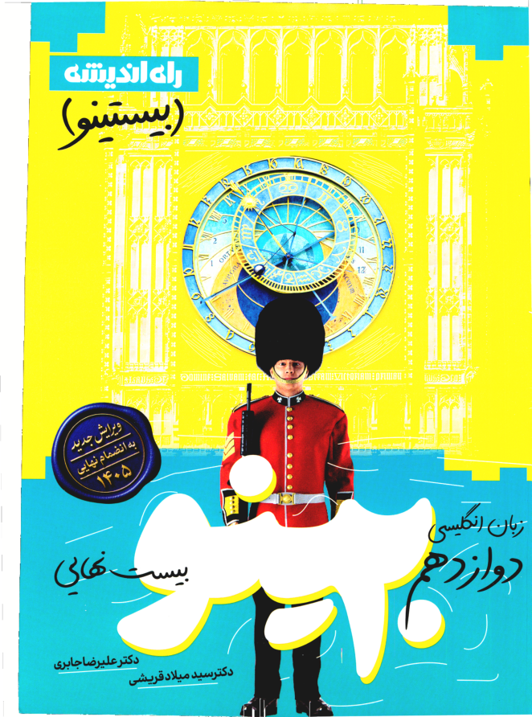
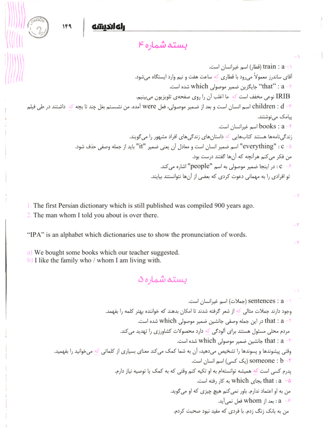
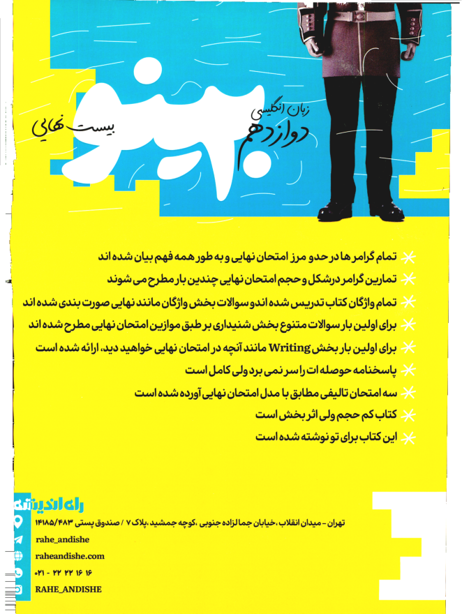
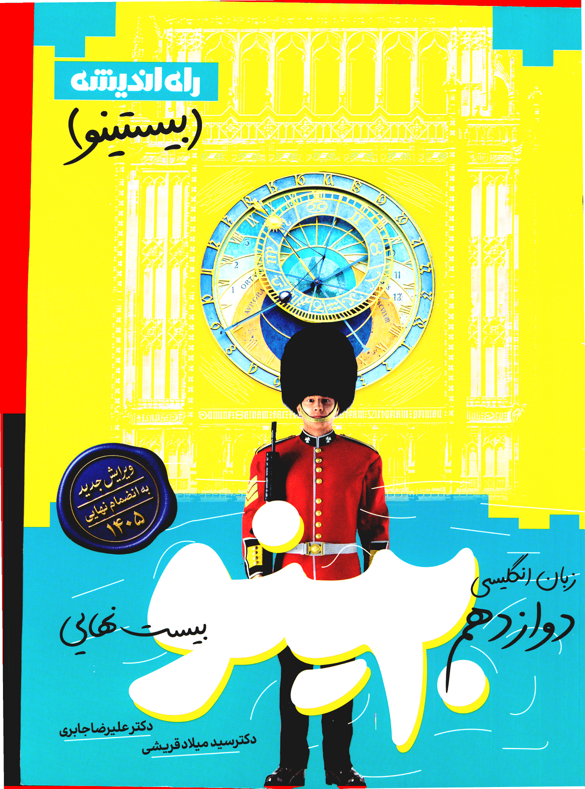
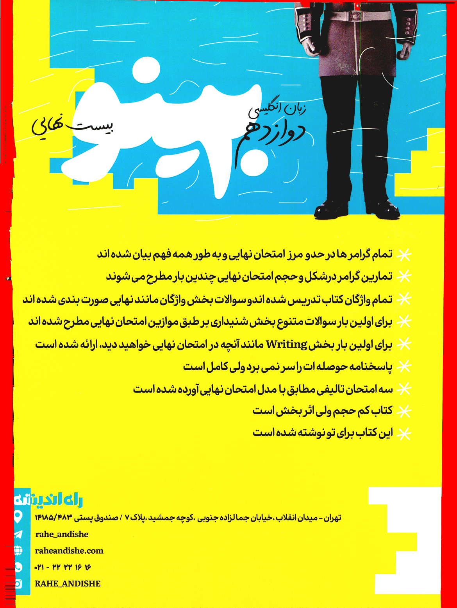

# کچاپ بوک — بیست‌ینو قریشی ۱۴۰۶ (بدون واترمارک، ترمیم‌شده)

کتاب 283 صفحه‌ای، اسکن‌شده (NAPS2 / PDFsharp، PDF 1.7). دو نسخه منتشر شده است:

## دانلود مستقیم

| نسخه | فایل | حجم | توضیح |
|---|---|---|---|
| مرحله ۲ | [`KECHAP_BOOK_BISTINO_1406_watermark-free.pdf`](https://github.com/AmirGFno/my-files/releases/download/v1/KECHAP_BOOK_BISTINO_1406_watermark-free.pdf) | 152,515,517 بایت | فقط واترمارک حذف شده؛ کیفیت اسکن هر صفحه بایت‌به‌بایت دست‌نخورده |
| مرحله ۳ | [`KECHAP_BOOK_BISTINO_1406_edges-repaired.pdf`](https://github.com/AmirGFno/my-files/releases/download/v1/KECHAP_BOOK_BISTINO_1406_edges-repaired.pdf) | 144,704,378 بایت | همان فایل + سفید شدن نوار سیاه لبه‌های اسکن |

صفحه ریلیز: https://github.com/AmirGFno/my-files/releases/tag/v1

> ریپو Private است؛ برای دانلود باید با حساب GitHub خود وارد شده باشید.
> گیت‌هاب نام asset را به ASCII تبدیل می‌کند؛ برای برگرداندن نام فارسی:

```bash
mv KECHAP_BOOK_BISTINO_1406_watermark-free.pdf "KECHAP_BOOK_بیست‌ینو قریشی 1406 (بدون واترمارک).pdf"
mv KECHAP_BOOK_BISTINO_1406_edges-repaired.pdf "KECHAP_BOOK_بیست‌ینو قریشی 1406 (ترمیم‌شده).pdf"
```

## SHA256

```
c2085ceed351ce21d9c7176b03b91d239197b41a2d09033c5c67b27a4fe88a41  KECHAP_BOOK_BISTINO_1406_watermark-free.pdf
49bab04c36ae2df51dabdc69dbbf794194c9f67f959f529b4d8cb4f986e8473a  KECHAP_BOOK_BISTINO_1406_edges-repaired.pdf
```

هر دو asset بعد از آپلود دوباره دانلود و SHA256 آن‌ها تطبیق داده شده است.

## مرحله ۲ — حذف واترمارک

واترمارک‌ها روی هر صفحه به‌صورت Artifact تزریق شده بودند (1698 بلوک در کل فایل).
استریم محتوای هر صفحه بازنویسی شد تا فقط قرارگیری تصویر اسکن پایه (`/I0`) باقی بماند:

- تمام بلوک‌های `/Artifact <</Subtype/Watermark/Type/Pagination>> BDC ... EMC` حذف شدند
- XObjectهای واترمارک `/FXX1 ../ FXX6` و گرافیک‌استیت `/FXE1 gs` حذف شدند
- عملیات متن و منابع فونت (واترمارک چرخیده Helvetica) حذف شدند
- در Catalog: `OCProperties`، `AcroForm` و `Names` صفر (null) شدند
- آبجکت‌های تصویری واترمارک با `garbage=4` واقعاً از فایل پاک شدند، نه پنهان

## مرحله ۳ — ترمیم لبه‌های سیاه

پردازش مستقیم روی پیکسل‌های تصویر تعبیه‌شده در PDF انجام شده؛ هیچ صفحه‌ای رندر یا
JPEG/دوباره فشرده نشده است (فقط استریم تصویر با deflate ذخیره شده).

- **۲۸۱ صفحه کاغذ سفید**: تشخیص لبه واقعی کاغذ در چهار طرف با اسکن
  «run روشن»، برازش خط مقاوم، پر کردن بیرون لبه با رنگ کاغذ همان صفحه، پاک‌سازی
  ریز‌نوارهای چسبیده به لبه و حذف لکه‌های تیره متصل به حاشیه (connected components)
- **۲ صفحه جلد رنگی**: لبه کاغذ وجود ندارد، پس لبه واقعی صفحه با «پله نوری تیز»
  (bright→dark) در ۳۰ پیکسل اول هر طرف پیدا می‌شود و فقط همان نوار باریک حذف
  می‌شود؛ جای نوار با رنگ پیکسل‌های همسایه همان خط پر می‌شود تا طرح ادامه پیدا کند.
  نوارهایی که از این عمق بیشتر باشند (مثل ساق پای نگهبان) طرح تلقی و دست‌نخورده
  می‌مانند
- در پایان، حداکثر ۶ پیکسل حاشیه هر صفحه از پیکسل‌های تیره بی‌رنگ پاک می‌شود

### نمونه‌های بصری

| جلد (بعد) | صفحه متنی ۱۵۱ (بعد) | صفحه آخر (بعد) |
|---|---|---|
|  |  |  |

### اعتبارسنجی قبل/بعد (اندازه‌گیری روی تصویر تعبیه‌شده)

```
pages: before=283 after=283 (scan images measured directly, no re-render)

 page  interior_dark      after  border_dark    after  dark_removed_deep  brightened
    1         177122     175581        13106       95                  0           0
   61          55614      55614        17016        8                  0           0
  151          42390      42390         9510        0                  0           0
  152          32032      32032         7766        0                  0           0
  250          80182      80182         8021        0                  0           0
  283         145508     145499        22703        6                  0           0

interior_dark = dark pixels inside the text area (identical before/after => no text touched)
border_dark   = dark pixels in the outer 6 px frame (scan band)
dark_removed_deep = dark->bright flips farther than 150 px from every border (must be 0)
brightened    = pixels that became darker (must be 0)

RESULT: PASS
```

`interior_dark` در چهار صفحه متنی نمونه (۶۱، ۱۵۱، ۱۵۲، ۲۵۰) قبل و بعد **کاملاً
یکسان** است: هیچ متنی پاک نشده است. دو صفحه جلد (۱ و ۲۸۳) لبه کاغذ ندارند، بنابراین
`interior_dark` آن‌ها کمی کاهش دارد — با بررسی تصویر diff (پایین) این کاهش مربوط به
نوار اسکن لبه است، نه طرح جلد.

`border_dark` در حاشیه ۶ پیکسلی از ۷٬۷۶۶–۲۲٬۷۰۳ به ۰–۹۵ رسیده، هیچ پیکسلی در کل فایل
تیره‌تر نشده (`brightened = 0`) و هیچ حذف تیره‌ای دورتر از ۱۵۰ پیکسل از لبه رخ نداده
(`dark_removed_deep = 0`).

### تصویر تغییرات روی جلدها

قرمز = پیکسل‌هایی که در مرحله ۳ عوض شده‌اند (فقط نوار لبه):





## اعتبارسنجی مرحله ۲

```
VALIDATION REPORT
=================
source file           : original.pdf
output file           : KECHAP_BOOK_بیست‌ینو قریشی 1406 (بدون واترمارک).pdf
source size (bytes)   : 152718885
output size (bytes)   : 152515517  (145.45 MiB)
sha256                : c2085ceed351ce21d9c7176b03b91d239197b41a2d09033c5c67b27a4fe88a41

pages                 : 283 (expected 283)
artifact blocks in src: 1698
BDC blocks left       : 0   (must be 0)
/FXX|/FXE refs left   : 0   (must be 0)
text operators left   : 0   (must be 0)
/Font refs in content : 0   (must be 0)
font objects in file  : 0   (must be 0)
watermark xobj names  : 0   (must be 0)
image objects in file : 283   (expected 283)
pages w/ pure content : 283/283
scan pixels identical : 283/283

catalog keys after cleanup:
  OCProperties -> ('null', 'null')
  AcroForm     -> ('null', 'null')
  Names        -> ('null', 'null')

RESULT: PASS
```

## بازسازی

```bash
pip install pymupdf numpy scipy
python tools/strip_watermarks.py original.pdf "out.pdf"
python tools/repair_edges.py "out.pdf" "out-repaired.pdf"
python tools/edge_stats.py "out.pdf" "out-repaired.pdf"
```

## اسکریپت‌ها

- `tools/strip_watermarks.py` — حذف واترمارک + اعتبارسنجی
- `tools/repair_edges.py` — ترمیم لبه‌های سیاه اسکن
- `tools/edge_stats.py` — اعتبارسنجی قبل/بعد مرحله ۳
- `tools/publish_release.py` — انتشار assetها و تطبیق SHA256 بعد از آپلود
- `.github/workflows/build.yml` — اجرای خودکار کل زنجیره (دانلود → حذف واترمارک →
  ترمیم لبه → اعتبارسنجی → انتشار)
